# Kino

Kino is a self-hosted service that listens to WhatsApp group messages through [OpenWA](https://github.com/rmyndharis/openwa), finds your kids in the incoming photos (including small, far-away faces), saves each photo into a per-kid folder, and forwards the saved photo to a WhatsApp chat you choose. Everything runs locally on CPU; no photo or face embedding leaves your host except the forwarded photo you asked for.

Named after the floating recording drones of Stargate Universe.

<!-- TODO: re-record demo to cover enroll, review, references, gallery -->
<video src="https://raw.githubusercontent.com/t0mer/Kino/main/assets/demo/demo.mp4" controls muted width="100%"></video>

[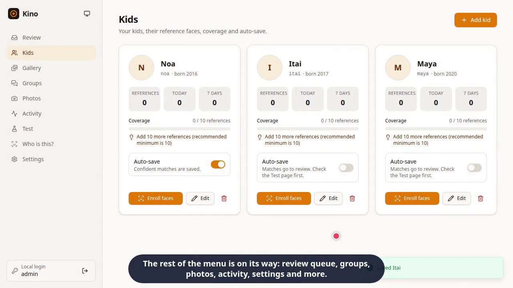](https://github.com/t0mer/Kino/blob/main/assets/demo/demo.mp4)

[Watch the demo video (MP4, 1 min 28 s)](https://github.com/t0mer/Kino/blob/main/assets/demo/demo.mp4)

## Contents

[Status](#status--known-gaps) · [Features](#features) · [Web UI](#web-ui) · [How it works](#how-it-works) · [Requirements](#requirements) · [Installation](#installation) · [Configuration](#configuration) · [CLI reference](#cli-reference) · [API endpoints](#api-endpoints) · [Privacy and retention](#privacy-and-retention) · [Security notes](#security-notes) · [Model licensing](#model-licensing) · [Troubleshooting](#troubleshooting) · [Development](#development) · [License](#license)

## Status / known gaps

Kino has the processing pipeline, the CLI and a web UI for teaching faces (kids, enrollment, review queue, references, groups with backfill, a gallery of saved photos, activity, a dry-run Test page, "Who is this?" clusters and settings). Retention cleanup and the review digest run in the background.

Not implemented yet, although their settings are accepted:

- **Burst propagation** (`KINO_BURST_ENABLED`): no effect; distant shots are only found by the tiled face pass.
- **Apprise digest targets** (`KINO_APPRISE_URLS` and the URL list in the Digest settings): the `apprise` package is not installed, so the URLs are stored and ignored (a warning is logged once). The digest goes to the WhatsApp chat chosen in Settings.

The OpenWA integration was checked read-only against a live OpenWA 0.24.0 instance (its OpenAPI spec and stored messages): the webhook filter grammar, the sender field (`author`, a privacy `@lid` id, falling back to `from`), the serialized message id format and the media download endpoint match. No real webhook delivery has been received yet, so these remain **unverified**:

- the real webhook delivery shape and its signature header
- the envelope `sessionId` (assumed to equal the session id used in REST paths)
- the `messageId` returned by send-image

`kino openwa register-webhook` updates a webhook that has the same URL; if the instance already has other webhooks (for example from another integration), it creates an additional one and leaves the others alone.

If your OpenWA differs, the first webhook delivery is where it will show up (see Troubleshooting).

## Features

- OpenWA webhook receiver with mandatory HMAC-SHA256 verification and a session check
- Group auto-discovery; only groups you mark as watched are processed
- Duplicate detection (perceptual hash) so a photo forwarded into several groups is processed once
- Face detection with SCRFD, full-image pass plus a tiled pass for small or distant faces
- Face quality tiers (size, blur, pose) and embedding on CPU with onnxruntime
- Matching against per-kid reference galleries, with thresholds per size tier, per-kid offset, group prior and a margin check
- Auto-save per kid (opt-in) to `photos/<kid>/<YYYY>/<MM>/<date>_<group>_<id>.jpg`, with EXIF date, description and artist; siblings in one photo are hardlinked
- Forwarding of saved photos to a configured WhatsApp chat through a single rate-limited queue, with retries
- Web UI to teach faces: enroll from photos or received images, a review queue with keyboard shortcuts, "Who is this?" clustering of unknown faces, reference management with outlier detection, a per-kid Gallery of saved photos, and a Test page to dry-run thresholds before enabling auto-save
- Backfill of the last 1 to 90 days of a group's history through OpenWA
- Retention cleanup of raw images, crops and embeddings, and a review digest message sent to a WhatsApp chat
- Two ways to sign in: a local admin login (LAN) and Cloudflare Access (tunnel)
- Prometheus metrics at `/metrics`, `/healthz` and `/readyz`
- CLI for enrolling kids, managing groups and kids, setting the forward destination, registering the webhook and benchmarking the pipeline

## Web UI

`kino api` serves the web UI and the REST API on port 8080 (the Docker image ships the built UI; see `KINO_WEB_DIR`). Every action in the UI maps to an `/api` endpoint (see [API endpoints](#api-endpoints)). The UI follows your system light or dark setting, with a toggle in the sidebar, and refreshes live data (review count, activity, jobs) on its own. Screenshots below use generated cartoon faces and made-up names, shown in light and dark mode (your browser picks the matching one on GitHub).

### First run and signing in

1. **Set the admin password from the LAN.** With no password configured, opening the UI shows a one-time setup page where you choose the admin password (at least 12 characters, stored as an argon2 hash in the database). The API refuses the setup from a request that came through a proxy or tunnel (it looks for `Cf-Ray`, `Cf-Connecting-Ip`, `X-Forwarded-For` or the Cloudflare Access token), so do it on `http://127.0.0.1:8080` or your LAN address **before** exposing Kino through a tunnel. Setup works once; afterwards the page returns an error. To skip it, set `KINO_ADMIN_PASSWORD_HASH` (an argon2 hash; it takes precedence over the stored one).
2. **Connect OpenWA.** Right after the password, the setup wizard asks for the OpenWA URL (for example `http://openwa:2785`), the API key and a webhook secret (type one with 16+ characters or press **Generate**), tests the connection, lists your OpenWA sessions (phone numbers masked) and registers Kino's webhook for the one you pick. The API key and secret are stored encrypted in the database; the encryption key is `/data/secret.key` (mode 600), so keep the `/data` volume together. Values set with `KINO_OPENWA_*` / `KINO_WEBHOOK_SECRET` win and show read-only. Reconnect later from **Settings > OpenWA**.

<picture>
  <source media="(prefers-color-scheme: dark)" srcset="assets/screenshots/openwa-wizard-dark.png">
  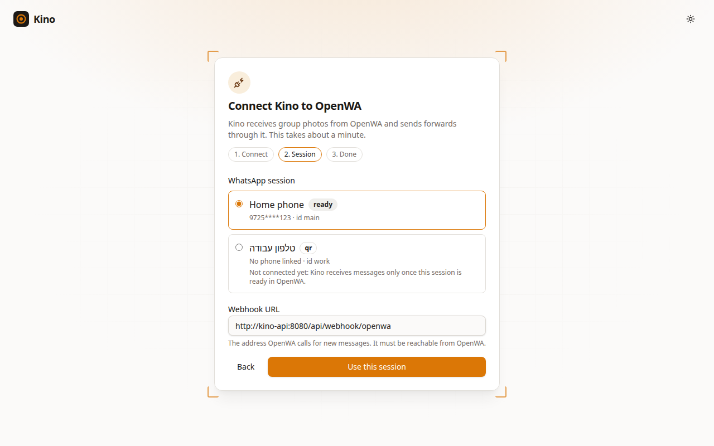
</picture>

3. **Sign in.** Two methods are active at the same time:
   - **Local login** (LAN): the user from `KINO_ADMIN_USER` (default `admin`) and the password. Sessions last 7 days in a secure, HTTP-only cookie; after 5 failed logins from one IP within 15 minutes that IP is locked out for a while.
   - **Cloudflare Access** (tunnel): when `KINO_CF_ACCESS_TEAM_DOMAIN` and `KINO_CF_ACCESS_AUD` are set, a request carrying a valid `Cf-Access-Jwt-Assertion` token is signed in automatically. Only the signed token counts (never the e-mail header). An invalid or expired token is rejected, with no fallback to the local login. `KINO_CF_ACCESS_ALLOWED_EMAILS` limits which e-mails are accepted.

   The sidebar footer shows which method signed you in.

<picture>
  <source media="(prefers-color-scheme: dark)" srcset="assets/screenshots/login-dark.png">
  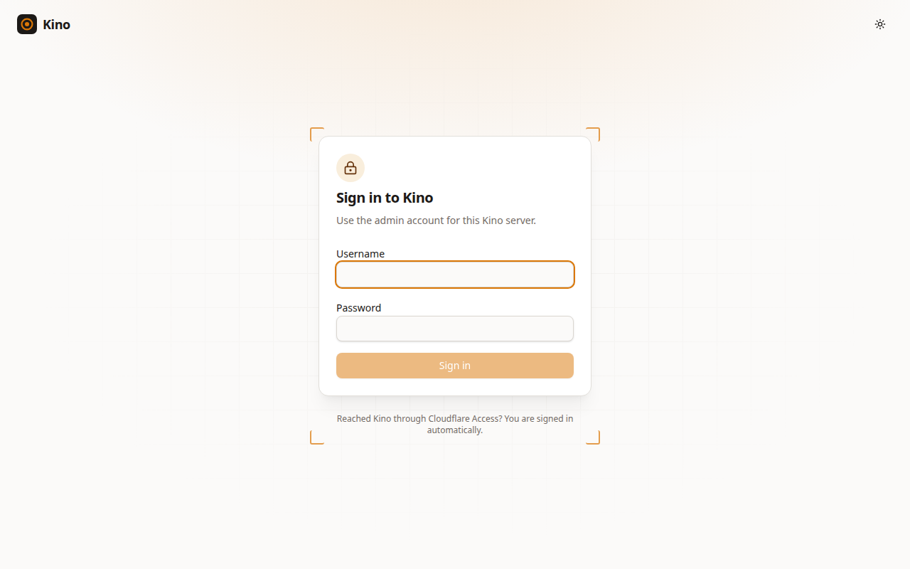
</picture>

### Kids

Create a kid with a name (any script, Hebrew included), an optional slug (used in folder names, transliterated from the name when empty), birth year, the groups they usually appear in, and a threshold offset (positive is stricter). Each card shows the reference count, photos saved today and in the last 7 days, a coverage meter (10 references recommended, with hints such as "add side angles" or "several references are over a year old") and the **auto-save** switch. Auto-save is off for a new kid: confident matches go to the review queue until you turn it on (see [Test](#test)).

<picture>
  <source media="(prefers-color-scheme: dark)" srcset="assets/screenshots/kids-dark.png">
  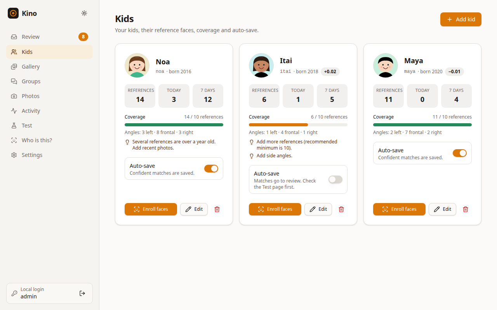
</picture>

### Enroll faces

From a kid's card, **Enroll faces** lets you drop photos (JPG, PNG, WebP, HEIC, up to 20 MB each) or **Pick from received photos** that Kino already processed. Kino detects the faces; click the box of the right kid in each photo (a photo with one usable face has a one-click **Use this face** button). Faces that are too small, too blurry or too far in profile cannot be picked, and a tooltip says why. The photo date comes from EXIF when present and can be edited; older references weigh less in matching.

<picture>
  <source media="(prefers-color-scheme: dark)" srcset="assets/screenshots/enroll-dark.png">
  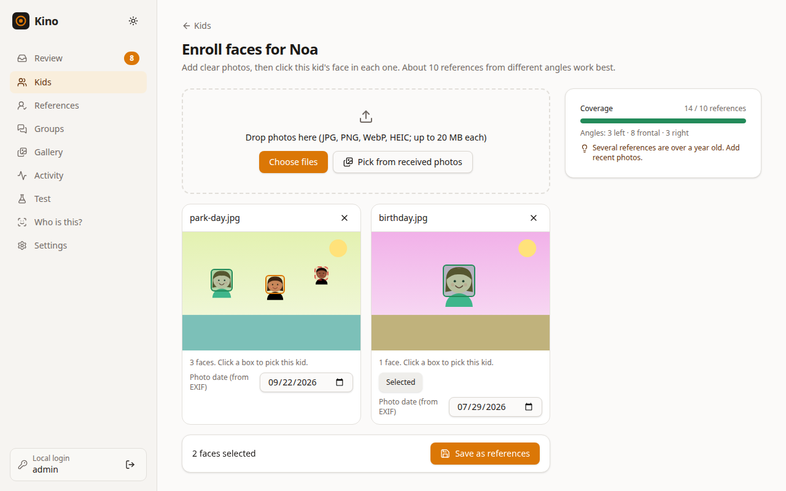
</picture>

### Review

Matches that are not sure enough to auto-save wait here. One-by-one view shows the face, the full photo with the face boxed, the score, tier and method, and the three closest references of the suggested kid. **Bulk** view is a grid with multi-select (shift-click selects a range) to confirm or reject many at once. Filter by kid and method. Confirming saves the photo (and forwards it, if you enabled that for confirmed photos) and, for a clear face, adds it as a reference; "It's someone else" also records a negative example so similar faces are penalised.

Keyboard shortcuts in the one-by-one view:

| Key | Action |
|---|---|
| `Y` | Confirm the suggested kid |
| `N` | Reject |
| `O` | "It's someone else": reject and remember as a negative example |
| `1` to `9` | "It's actually kid N": reassign (numbers are shown on the buttons) |
| `S` | Skip (the item moves to the end of the queue) |

Shortcuts are ignored while you type in a field or while a dialog is open, and a held key does not repeat.

<picture>
  <source media="(prefers-color-scheme: dark)" srcset="assets/screenshots/review-dark.png">
  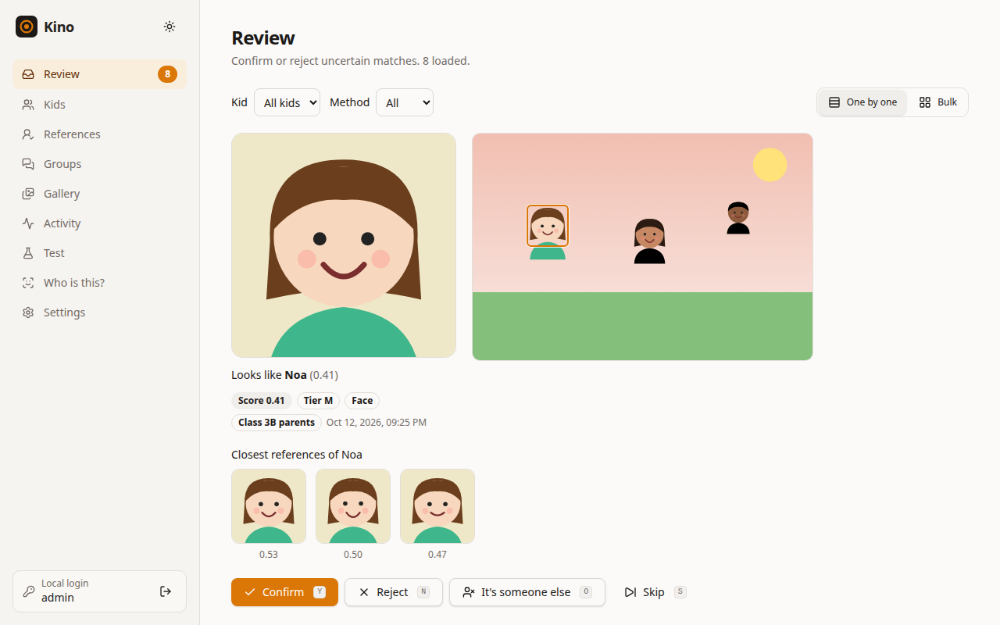
</picture>

<picture>
  <source media="(prefers-color-scheme: dark)" srcset="assets/screenshots/review-bulk-dark.png">
  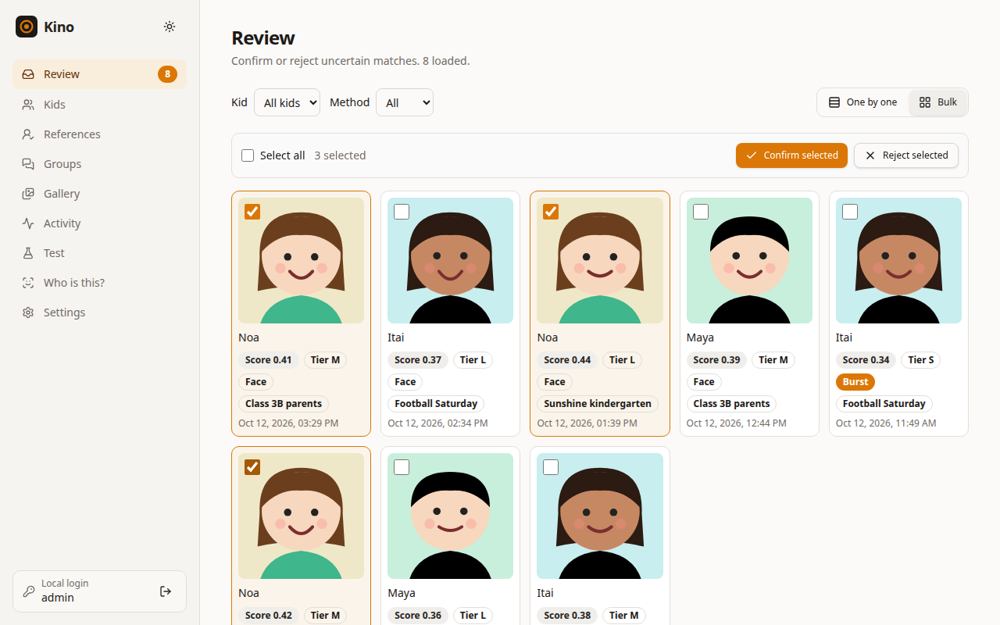
</picture>

### References

Teach Kino each kid's face. Pick a kid to see all of their reference faces, with filters for source (upload, cluster, review, auto), status and date, a coverage meter and a histogram of photo dates by month, so age drift is visible. **Add references** opens the enroll page. References that look wrong are flagged as **outliers** (far from the kid's other references, or closer to another kid) by a nightly check and listed first. Each reference can be retired or reactivated, re-dated, moved to another kid, marked as someone else, or deleted. (This page was called "Gallery" before the photos page was renamed; it lives at `/references`.)

<picture>
  <source media="(prefers-color-scheme: dark)" srcset="assets/screenshots/references-dark.png">
  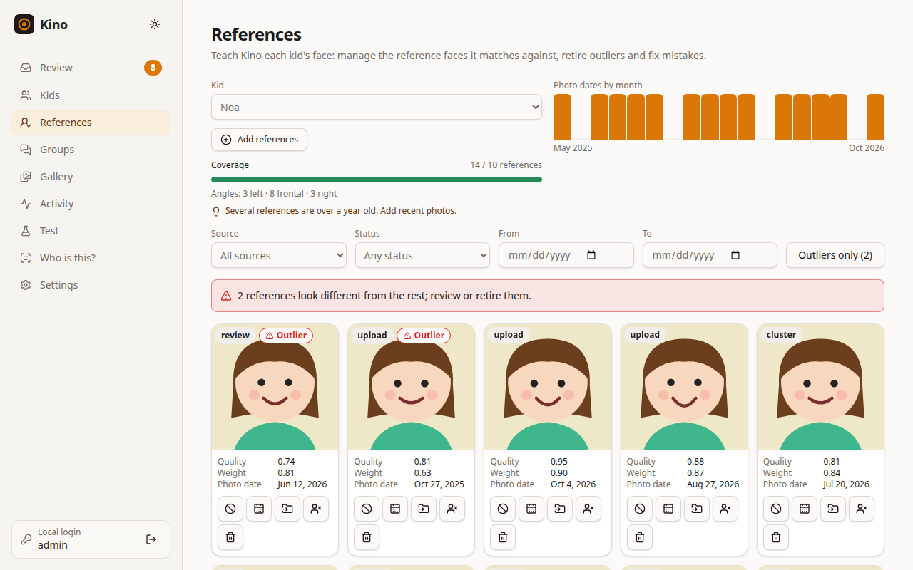
</picture>

### Groups

Groups are discovered when a message arrives, or imported from OpenWA with **Refresh**; they start unwatched. Switch **Watched** on for the groups to process and mark the kids who usually appear in each one (a small score bonus for those kids). **Backfill** imports the last 1 to 90 days (default 30) of a group's history through the same path as live messages, with the same duplicate detection, and shows a progress bar. Imports are paced (`KINO_BACKFILL_DELAY_SECONDS`) to stay gentle with WhatsApp.

<picture>
  <source media="(prefers-color-scheme: dark)" srcset="assets/screenshots/groups-dark.png">
  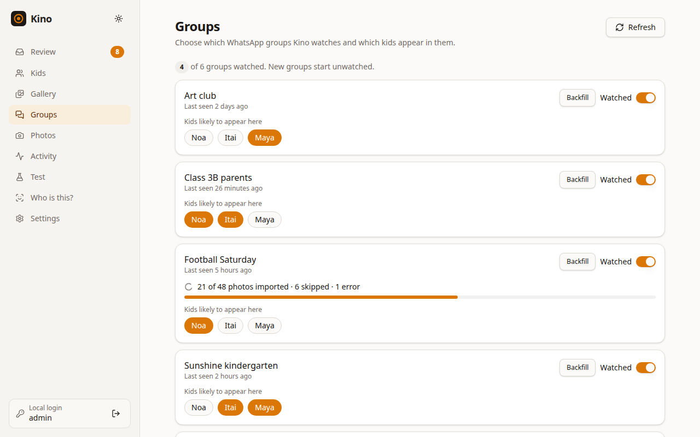
</picture>

### Gallery

The photos Kino identified and saved, at `/gallery` (the old `/photos` address redirects here). Tabs for **All** and each kid show how many photos each has; photos are grouped under month headings and shown as thumbnails. In a kid's tab, a photo that was also saved for another kid carries a badge with their name; in the All tab every thumbnail lists all of its kids. Filter by group and date range. Open a photo for the lightbox: the original, the kids, group, sent time and sender (hidden when it would be a phone number), previous/next paging that continues across pages, and a **Remove from kid** button per kid. Removing deletes that kid's file and cancels its unsent forward (already sent WhatsApp messages are not deleted).

<picture>
  <source media="(prefers-color-scheme: dark)" srcset="assets/screenshots/gallery-dark.png">
  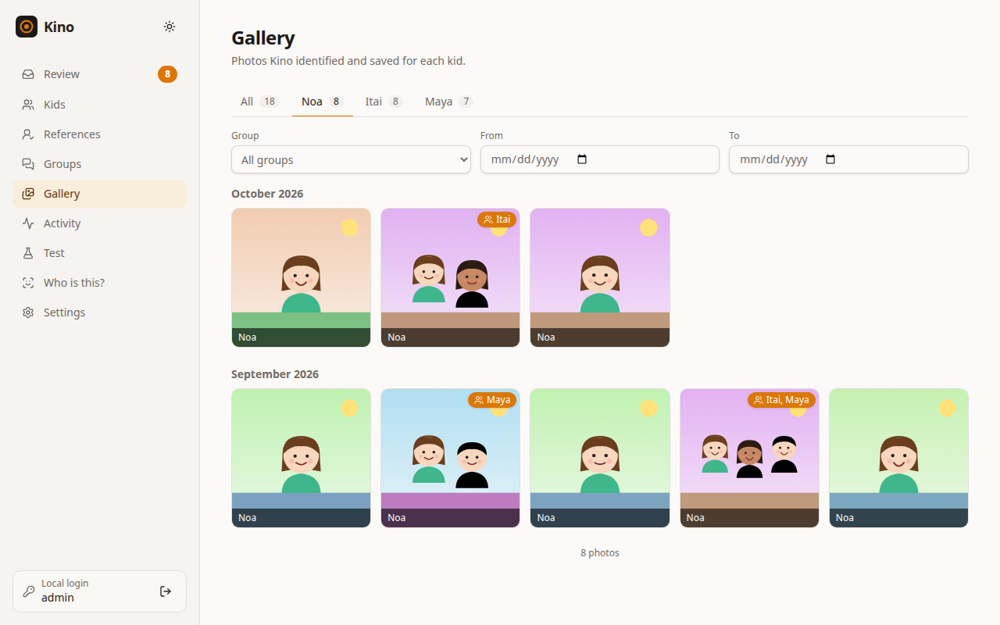
</picture>

<picture>
  <source media="(prefers-color-scheme: dark)" srcset="assets/screenshots/gallery-lightbox-dark.png">
  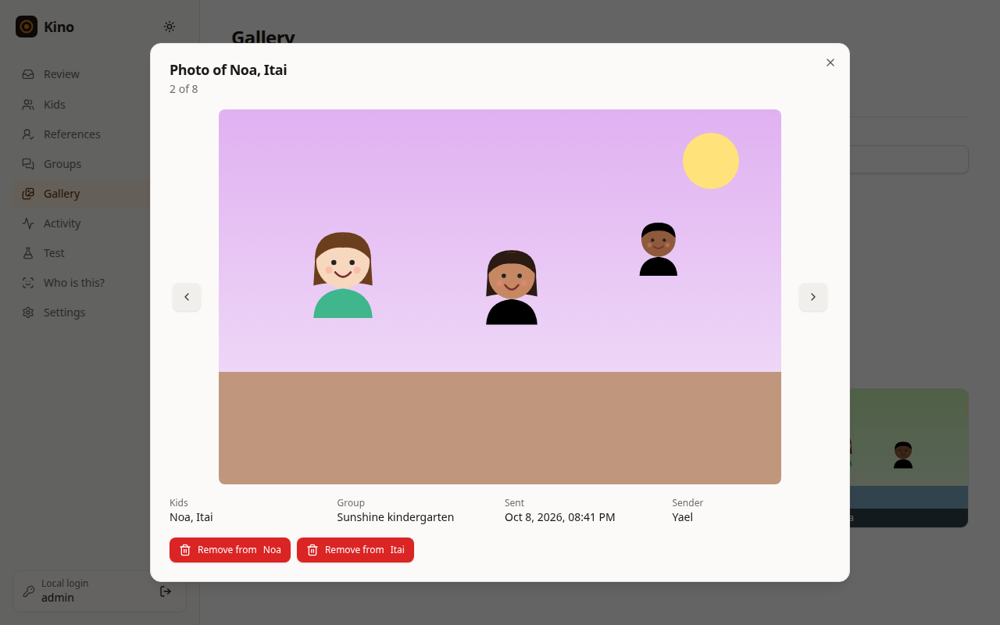
</picture>

### Activity

Stats (processed, queued, review pending, forwards waiting), then the recent images with their pipeline outcome (done, skipped as duplicate, failed, queued). Open an image to see every detected face with its box, size tier, quality, scores and decision, plus its forwards. The **Forwards** tab lists failed forwards with a **Retry** button, and forwards still pending.

<picture>
  <source media="(prefers-color-scheme: dark)" srcset="assets/screenshots/activity-dark.png">
  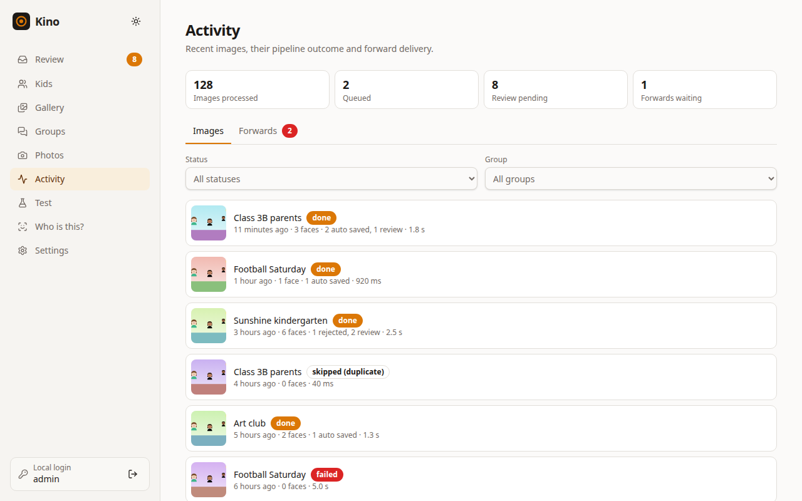
</picture>

<picture>
  <source media="(prefers-color-scheme: dark)" srcset="assets/screenshots/activity-detail-dark.png">
  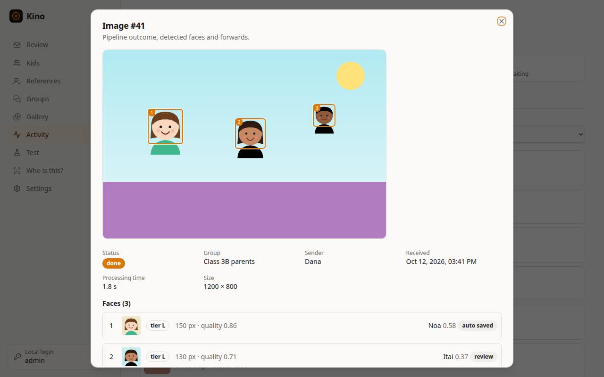
</picture>

<picture>
  <source media="(prefers-color-scheme: dark)" srcset="assets/screenshots/activity-forwards-dark.png">
  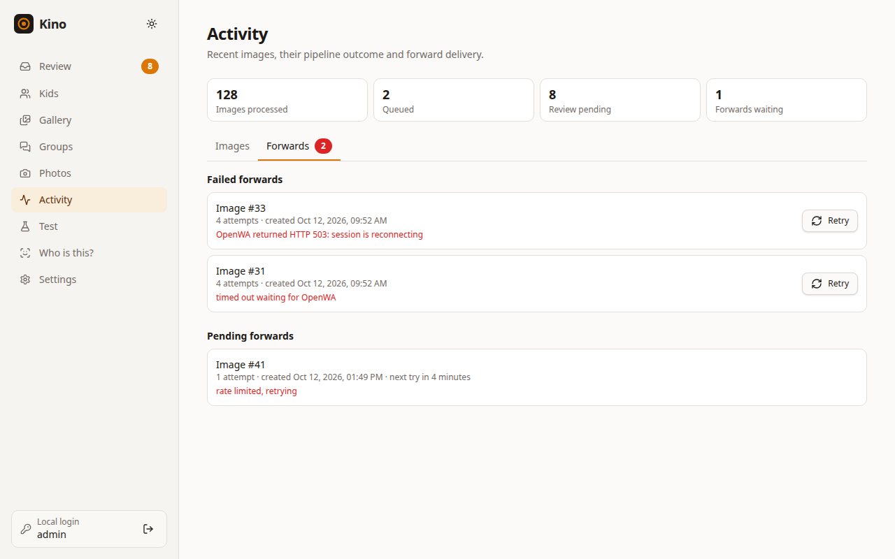
</picture>

### Test

A dry run over stored faces, with nothing saved until you apply it. Pick a kid (or all), a date range (default the last 14 days) and move the sliders per tier; Kino re-scores server-side and shows what **would auto-save**, **would review** and **would drop**. Click a crop to flag it as wrong (send it to review, or add it as a negative example). **Apply thresholds** stores the values; **Re-score last N days** (1 to 365) re-runs matching on stored faces after you changed references or thresholds, without detecting faces again. Decisions you already made are kept.

**Recommended workflow before turning on auto-save for a kid:** enroll at least 10 references, let a few days of photos arrive (or backfill), open Test, check that "would auto-save" contains only that kid, flag the mistakes, adjust the thresholds, apply, and only then switch on **Enable auto-save** for the kid.

<picture>
  <source media="(prefers-color-scheme: dark)" srcset="assets/screenshots/test-dark.png">
  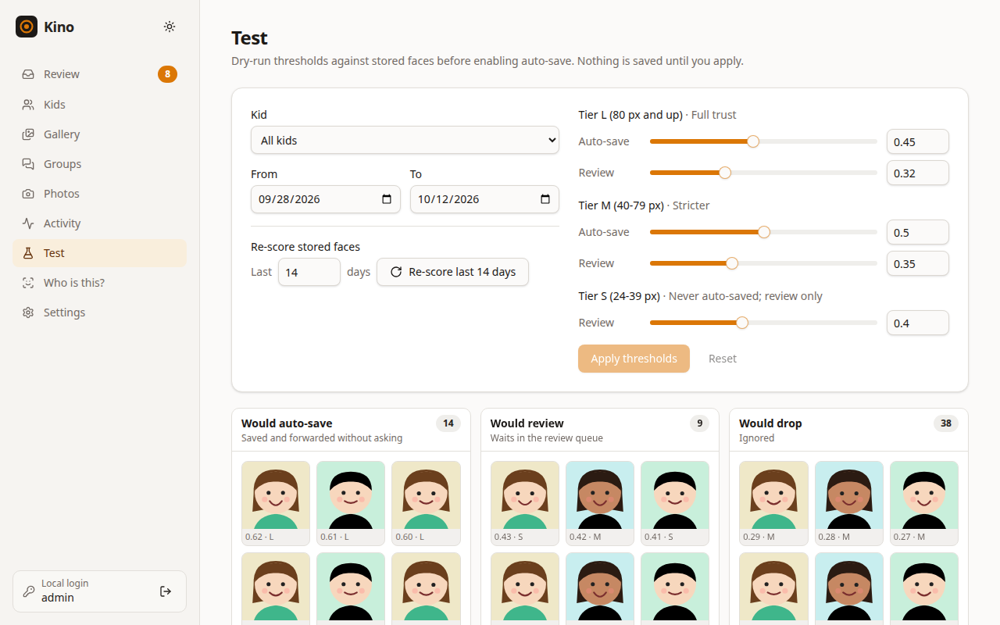
</picture>

### Who is this?

Unknown faces from the last 60 days are grouped nightly (03:30 server time) and on demand with **Find clusters now**. Open a cluster, deselect faces that do not belong, then choose the kid: the faces become references and Kino re-scores. **Not my kid / ignore** permanently deletes the cluster's crops and embeddings; **Split** re-clusters a mixed cluster more finely.

**Bootstrapping a new install:** watch a group on the Groups page, run a backfill (or use "Import the last 30 days" on this page when it is empty), wait for the clustering, label the clusters, then check the results on the Test page.

<picture>
  <source media="(prefers-color-scheme: dark)" srcset="assets/screenshots/clusters-dark.png">
  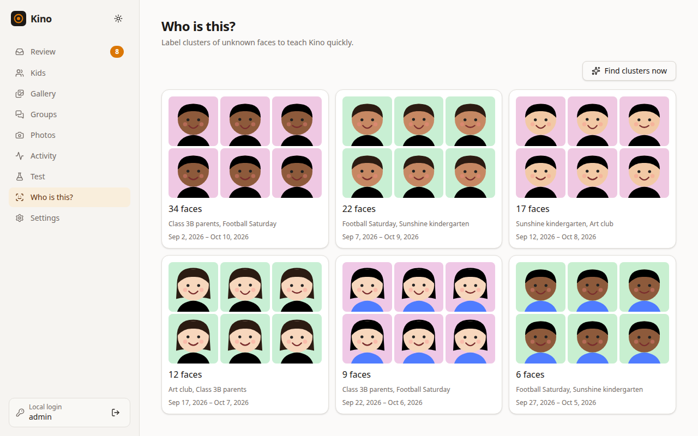
</picture>

<picture>
  <source media="(prefers-color-scheme: dark)" srcset="assets/screenshots/clusters-open-dark.png">
  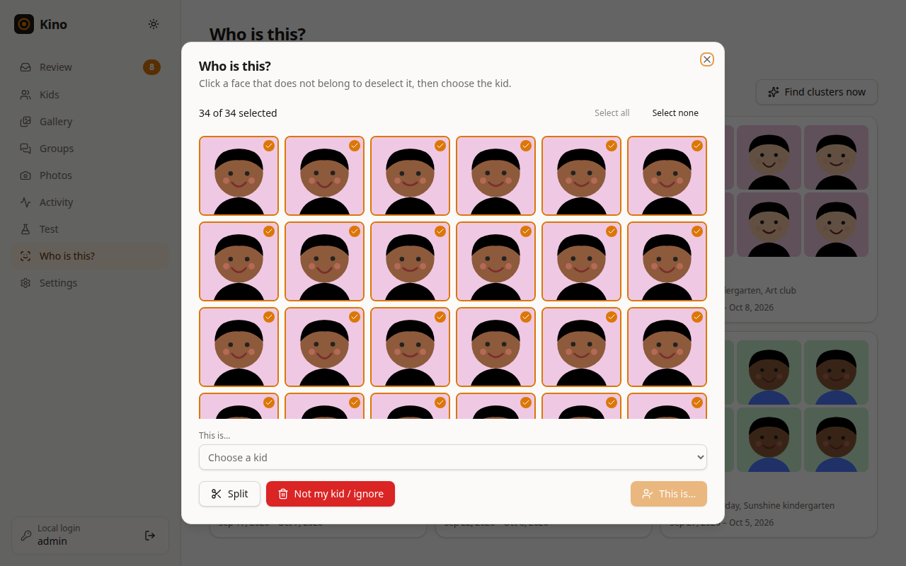
</picture>

### Settings

- **OpenWA**: the current connection (URL, session, whether the API key and webhook secret are saved, webhook URL; values from environment variables marked read-only) and a **Reconnect** button that opens the setup wizard.
- **Forwarding**: switch it on, pick the default destination chat or group from a searchable list (watched groups are disabled, otherwise Kino would ingest its own photos), optional per-kid destinations, and the caption template with a live preview (`{kids}`, `{group}`, `{sender}`, `{date}`, `{time}`). **Send test photo** sends a real message. Optionally also forward photos you confirm in the review queue.
- **Digest**: the chat that receives the review digest, the schedule (a 5-field cron expression, empty disables it) and the public base URL used in the message link.
- **Thresholds**: auto-save and review values per size tier plus the group bonus, unmapped-group penalty and minimum margin. Auto-save never goes below the floor of 0.30.
- **Retention**: days to keep unmatched raw images and unmatched faces.
- **System**: embedder, model files with licence and checksum, the OpenWA webhook status with a **Register webhook** (or **Repair webhook**) button, and the version.

<picture>
  <source media="(prefers-color-scheme: dark)" srcset="assets/screenshots/settings-openwa-dark.png">
  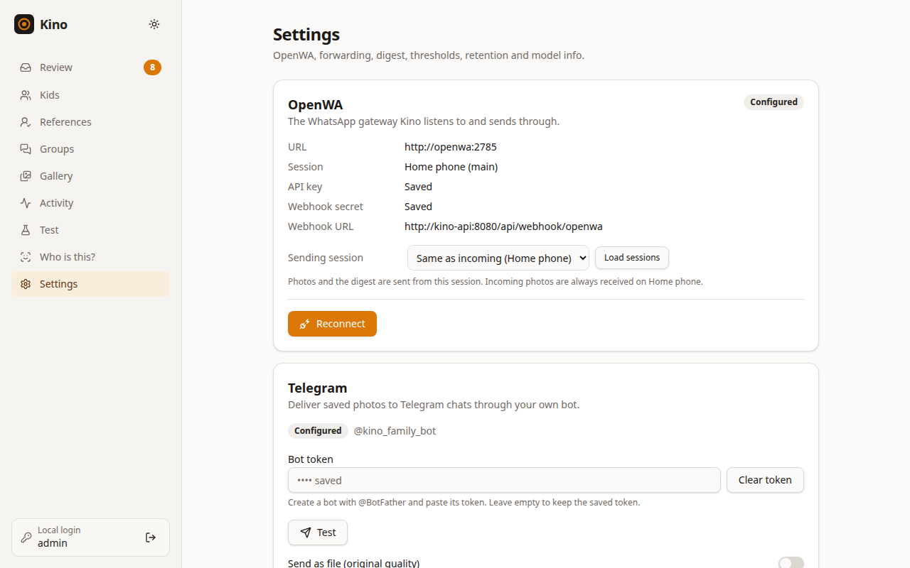
</picture>

<picture>
  <source media="(prefers-color-scheme: dark)" srcset="assets/screenshots/settings-forwarding-dark.png">
  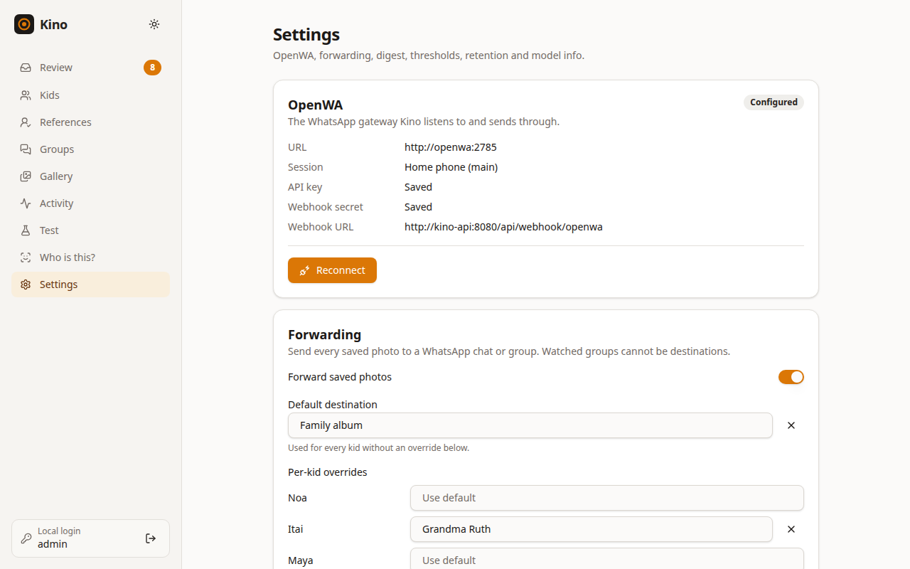
</picture>

<picture>
  <source media="(prefers-color-scheme: dark)" srcset="assets/screenshots/settings-thresholds-dark.png">
  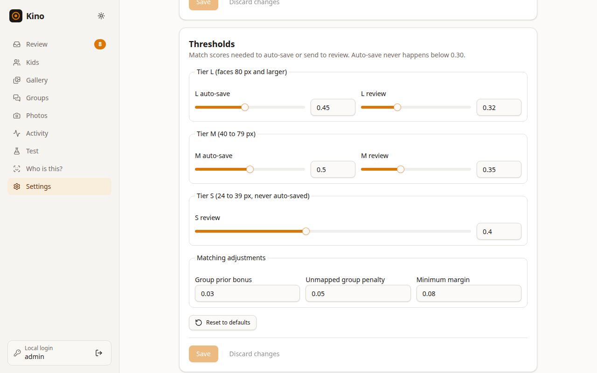
</picture>

### Retention and the digest

- **Retention** runs hourly. Raw images that matched no kid are deleted after 7 days (a raw file is kept while a review item or an unfinished forward needs it), and embeddings and crops of faces that are not matched to a kid, nor used as references or negatives, after 30 days. Edit the values under Settings; the `KINO_*_RETENTION_DAYS` variables are the defaults.
- **Digest**: at the configured time Kino sends one WhatsApp message such as "7 photos waiting for review (Noa 4, Itai 3) · https://your-host/review". Nothing is sent when no photo waits for review, and the same pending set is not announced twice: a new digest goes out only when the set of items waiting for review changed since the previous digest. The schedule is evaluated in `KINO_TIMEZONE`.

## How it works

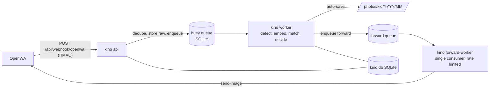

`kino-api`, `kino-worker` and `kino-forward-worker` are the same image started with different commands, sharing the `/data` volume.

## Requirements

- Docker with Compose (amd64 or arm64), or Python 3.12 for a local install
- A running OpenWA with a connected WhatsApp session, its URL, API key and session id
- About 3 GB of RAM for the worker and a few hundred MB of disk for models (downloaded on first use)

## Installation

### Docker Compose (recommended)

```bash
git clone https://github.com/t0mer/kino && cd kino
cp .env.example .env
# optional: put OpenWA settings in .env, or connect OpenWA in the web UI after the first sign-in
mkdir -p photos && sudo chown 1000:1000 photos   # the container runs as uid 1000
docker compose up -d
```

The example compose file publishes the API (8080) and OpenWA (2785) on `127.0.0.1` only. OpenWA is reached by Kino over the internal Docker network and should stay private. To reach Kino from elsewhere, first open the UI on `http://127.0.0.1:8080` (or your LAN address) and set the admin password (see [First run and signing in](#first-run-and-signing-in)), then put a Cloudflare Tunnel or a reverse proxy in front of it (do not route `/api/webhook/openwa` there), or change the mapping to `8080:8080` on a trusted LAN only.

`/data` is a named volume (`kino-data`) holding the database, queues, raw images, crops and models. The `./photos` bind mount must be writable by uid 1000. Run the forward worker as exactly one instance; do not scale it.

Open the [Web UI](#web-ui) to set the admin password and teach faces there, or do the same with the CLI inside the running container (`docker compose exec kino-api kino ...`):

```bash
# 1. Download the models (otherwise they are fetched on first use)
docker compose exec kino-api kino models download

# 2. Register Kino's webhook in OpenWA (the setup wizard already did this if you used it)
docker compose exec kino-api kino openwa register-webhook

# 3. Enroll each kid from a folder of clear photos (10 or more, varied angles)
docker compose run --rm -v "$PWD/enroll/Noa:/enroll:ro" kino-api enroll "Noa" /enroll

# 4. Find your groups (they appear once a message arrives, or fetch names from OpenWA) and watch them
docker compose exec kino-api kino groups list
docker compose exec kino-api kino groups watch 1203...@g.us --kid Noa --fetch

# 5. Check results in the database/logs, then turn on auto-save for the kid
docker compose exec kino-api kino kids set-auto-save Noa --on

# 6. Choose where saved photos are forwarded (must not be a watched group)
docker compose exec kino-api kino forward set 972501234567@c.us
```

Until auto-save is on for a kid, matches are not saved (they go to the review queue). Forwarding is off until a destination is chosen with `kino forward set` or in Settings.

### Local install

```bash
uv venv && uv pip install -e ".[dev]"
KINO_DATA_DIR=./data KINO_PHOTOS_DIR=./data/photos .venv/bin/kino migrate
```

## Configuration

Precedence: environment variables (`KINO_*`) > `/data/config.yaml` (in `KINO_DATA_DIR`; keys are the variable names without the prefix, see `config.example.yaml`) > built-in defaults.

Settings you edit in the web UI (forwarding, digest, thresholds, retention) are stored in the database and take precedence over the matching `KINO_*` defaults below.

OpenWA settings saved by the setup wizard live in the database too, but here the environment wins: a set `KINO_OPENWA_*` or `KINO_WEBHOOK_SECRET` overrides the wizard field by field.

| Variable | Default | Description |
|---|---|---|
| `KINO_DATA_DIR` | `/data` | Root for the database, queues, raw images, crops, models and `config.yaml` |
| `KINO_WEB_DIR` | `/opt/venv/share/kino/web` | Built web UI served by `kino api`. The image ships it here; if the directory is missing only the API is served |
| `KINO_PHOTOS_DIR` | `/data/photos` | Output root for saved photos |
| `KINO_STRIP_GPS` | `true` | Remove GPS EXIF from saved (and therefore forwarded) photos |
| `KINO_TIMEZONE` | `UTC` | IANA zone used for photo folders, file names and EXIF local time (for example `Asia/Jerusalem`) |
| `KINO_OPENWA_URL` | unset | OpenWA base URL, for example `http://openwa:2785`. Optional: or set it in the setup wizard; when set here it wins and is read-only in the UI |
| `KINO_OPENWA_API_KEY` | unset | OpenWA API key. Optional: or set it in the setup wizard (stored encrypted) |
| `KINO_OPENWA_SESSION_ID` | unset | The single OpenWA session; webhooks from other sessions are rejected. Optional: or pick it in the setup wizard |
| `KINO_WEBHOOK_SECRET` | unset | HMAC secret for webhook verification (16+ characters). Optional: or set/generate it in the setup wizard (stored encrypted). Until one is configured the webhook answers 503 |
| `KINO_ADMIN_USER` | `admin` | Admin user name for the local login |
| `KINO_ADMIN_PASSWORD_HASH` | unset | Argon2 hash of the admin password. Takes precedence over the password chosen on the first-run setup page |
| `KINO_SECRET_KEY` | unset | Cookie signing key. When unset, one is generated once and kept in the database |
| `KINO_CF_ACCESS_TEAM_DOMAIN` | unset | Cloudflare Access team domain, for example `myteam.cloudflareaccess.com`; leave empty to disable Cloudflare Access sign-in |
| `KINO_CF_ACCESS_AUD` | unset | Cloudflare Access application AUD tag |
| `KINO_CF_ACCESS_ALLOWED_EMAILS` | unset | Comma-separated allowed e-mails; empty accepts any e-mail Cloudflare Access lets through |
| `KINO_METRICS_PUBLIC` | `false` | Serve `/metrics` without authentication (needed for LAN Prometheus scraping; otherwise `/metrics` requires a signed-in session) |
| `KINO_METRICS_DIR` | `<KINO_DATA_DIR>/metrics` | Shared directory where every Kino process (API, workers, forward worker) writes its Prometheus counters; `/metrics` merges them |
| `KINO_EMBEDDER` | `auraface` | `auraface` or `buffalo_l` (see Model licensing) |
| `KINO_DET_SIZE` | `1024` | Detector input size for the full-image pass; a multiple of 32, at least 32 |
| `KINO_TILING` | `auto` | `off`, `auto` or `always` |
| `KINO_TILE_GRID` | `auto` | `2x2`, `3x3` or `auto` |
| `KINO_TILE_OVERLAP` | `0.2` | Tile overlap, from 0 up to but excluding 1 |
| `KINO_WORKERS` | `2` | Worker processes for `kino worker` (at least 1) |
| `KINO_ORT_THREADS` | `2` | onnxruntime threads per process (at least 1) |
| `KINO_FORWARD_RATE_PER_MIN` | `6` | Maximum forwarded photos per minute (at least 1) |
| `KINO_BACKFILL_DELAY_SECONDS` | `1.0` | Pause after each photo fetched during a group backfill (0 or more) |
| `KINO_RAW_RETENTION_DAYS` | `7` | Days to keep raw images that matched no kid. Default only: the value saved in Settings wins |
| `KINO_FACE_RETENTION_DAYS` | `30` | Days to keep embeddings and crops of faces not matched to a kid. Default only: the value saved in Settings wins |
| `KINO_BURST_ENABLED` | `false` | Reserved; burst propagation is not implemented yet |
| `KINO_DIGEST_CRON` | `0 20 * * *` | Review digest schedule (5-field cron, evaluated in `KINO_TIMEZONE`; empty disables it). Default only: the schedule saved in Settings wins. The destination chat is set in Settings |
| `KINO_APPRISE_URLS` | unset | Comma-separated notification URLs for the digest. Stored but not used yet (Apprise is not installed) |
| `KINO_LOG_LEVEL` | `INFO` | Log level |
| `KINO_LOG_JSON` | `false` | JSON log lines |

The Docker image additionally reads `KINO_VERSION`, set at build time from the release version and reported by `kino version` and `/healthz`.

## CLI reference

Run `kino --help` or `kino <command> --help` for all options. In the container the entrypoint is `kino`, so `docker run techblog/kino version` works.

| Command | Description |
|---|---|
| `kino version` | Print the version |
| `kino migrate` | Create or upgrade the database schema (the api and workers also migrate on start) |
| `kino api [--host] [--port]` | Run the HTTP API (default `0.0.0.0:8080`) |
| `kino worker [-w N]` | Run the image-processing worker (main queue) |
| `kino forward-worker` | Run the forwarding worker; run exactly one instance |
| `kino enroll <kid> <dir> [--slug] [--birth-year] [--group]` | Enroll reference faces for a kid from a folder of photos (kid created if missing) |
| `kino bench <dir> [--repeat N]` | Time detect, quality and embed on real images without database writes |
| `kino models download [--embedder auraface\|buffalo_l] [--all]` | Download and verify models |
| `kino groups list` | List discovered groups |
| `kino groups watch <chat_id> [--kid NAME]... [--fetch]` | Watch a group; `--kid` replaces its kid mapping, `--fetch` imports group names from OpenWA |
| `kino groups unwatch <chat_id>` | Stop watching a group |
| `kino kids list` | List kids |
| `kino kids set-auto-save <kid> --on\|--off` | Enable or disable auto-save for a kid |
| `kino kids set-offset <kid> <offset>` | Shift a kid's thresholds (positive is stricter; allowed range -0.10 to +0.30; use `--` before negative values). Whatever the offset and group prior, the tier L/M auto-save threshold never goes below 0.30 |
| `kino forward set <chat_id>` | Set the default forward destination and enable forwarding |
| `kino forward show` | Show the forwarding configuration |
| `kino forward disable` | Disable forwarding (destination kept) |
| `kino forward list [--status S] [--limit N]` | List forwards, newest first (`pending`, `sent`, `failed`, `cancelled`) |
| `kino forward retry <id>` | Retry a failed forward |
| `kino openwa register-webhook [--url URL]` | Register or update the webhook in OpenWA (default URL `http://kino-api:8080/api/webhook/openwa`) |

## API endpoints

Interactive docs are not served; this table is the reference. All routes need a signed-in session (local cookie or Cloudflare Access token) except the ones marked "open". State-changing requests from a browser must send the `X-CSRF-Token` header with the value of the `kino_csrf` cookie (set by `GET /api/auth/status`). Lists with a `cursor` return `next_cursor` for the next page.

| Method and path | Purpose |
|---|---|
| `POST /api/webhook/openwa` | OpenWA webhook (HMAC-verified, open) |
| `GET /healthz`, `GET /readyz` | Liveness (status and version) and readiness (open) |
| `GET /metrics` | Prometheus metrics; needs a session unless `KINO_METRICS_PUBLIC=true` |
| `GET /api/auth/status` | Whether first-run setup is required (open) |
| `POST /api/auth/setup` | One-time admin password, LAN only (open) |
| `POST /api/auth/login`, `POST /api/auth/logout` | Local login and logout |
| `GET /api/auth/me` | Who is signed in and by which method (`local` or `cloudflare`) |
| `GET/POST /api/kids`, `GET/PATCH/DELETE /api/kids/{id}` | List, create, read, update and delete kids |
| `GET /api/kids/{id}/coverage` | Reference coverage and hints |
| `GET /api/kids/{id}/health` | Live outlier check of the kid's active references |
| `POST /api/kids/{id}/uploads` | Upload photos for enrollment; returns the detected faces |
| `GET /api/temp-crops/{temp_face_id}` | Crop of an uploaded face (temporary) |
| `GET/POST /api/kids/{id}/references` | List references; add references from uploaded faces |
| `GET/PATCH/DELETE /api/references/{id}` | Read, update (status, kid, photo date) and delete a reference |
| `POST /api/references/{id}/to-negative` | Turn a reference into a negative example |
| `GET /api/references/{id}/crop` | Crop image of a reference |
| `GET /api/review`, `GET /api/review/count` | Review queue (filter by kid and method) and its size |
| `POST /api/review/{match_id}` | Decide one item: `confirm`, `reject`, `someone_else` or `reassign` |
| `POST /api/review/bulk` | Confirm or reject many items |
| `GET /api/groups`, `PATCH /api/groups/{id}` | List groups; set `watched` and the kid mapping |
| `POST /api/groups/refresh` | Import group names from OpenWA |
| `POST /api/groups/{id}/backfill?days=N` | Start a history backfill (1 to 90 days, default 30); returns a job id |
| `GET /api/jobs`, `GET /api/jobs/{id}` | Background jobs (backfill progress) |
| `GET /api/clusters`, `GET /api/clusters/{id}` | Unlabeled clusters of unknown faces and their faces |
| `POST /api/clusters/{id}/label`, `/ignore`, `/split` | Label a cluster as a kid, ignore it (deletes its data), or split it |
| `POST /api/clusters/run` | Run clustering now |
| `GET /api/photos` | Saved photos (filter by `kid_id`, `group_id`, `from`, `to`; cursor paging). Each item has `kids` (every kid the image was saved for, with that kid's `saved_photo_id`), `thumb_url`, `file_url` and `sender_name` (null when it would be a phone number) |
| `GET /api/photos/counts` | Photo counts for the Gallery tabs: `{total, kids: [{kid_id, kid_name, count}]}`, honouring the group and date filters |
| `GET /api/photos/{id}/thumb` | JPEG thumbnail of a saved photo (`?w=` is rounded up to 160, 240, 320, 400, 640, 800 or 1024; default 400), cached under `/data/thumbs` |
| `DELETE /api/photos/{id}` | Remove a saved photo from one kid |
| `GET /api/images`, `GET /api/images/{id}` | Processed images and the detail of one (faces, matches, forwards) |
| `GET /api/images/{id}/file`, `GET /api/crops/{face_id}` | Original image and face crop files |
| `GET /api/forwards`, `POST /api/forwards/{id}/retry` | List forwards by status; retry a failed one |
| `POST /api/forward/test` | Send a test photo to a chat |
| `POST /api/test/score` | Dry-run scoring with candidate thresholds |
| `POST /api/test/flag` | Flag a dry-run face as wrong (send to review or add as negative) |
| `POST /api/rescore` | Re-score stored faces of the last N days |
| `GET /api/settings` | All settings, model info and version |
| `GET/PUT /api/settings/forward`, `/digest`, `/thresholds`, `/retention` | Read or replace one settings section |
| `POST /api/settings/forward/preview` | Render the caption template for a sample |
| `GET /api/openwa/chats` | Contacts and groups for the destination pickers |
| `GET /api/openwa/webhook`, `POST /api/openwa/webhook/register` | Webhook status; register or repair it |
| `GET /api/openwa/setup/status` | OpenWA connection for the wizard: configured flag, URL (no credentials), session, `has_api_key` / `has_webhook_secret`, webhook URL, fields locked by env |
| `POST /api/openwa/setup/connect` | Test URL + API key against OpenWA, then save them and the webhook secret (blank keeps the stored value; a missing secret is generated); returns the sessions |
| `POST /api/openwa/setup/session` | Save the picked session (checked against the live list) and register the webhook; a failed registration is reported in `error` and can be retried |
| `GET /api/stats` | Counters used by the Activity page |

`/metrics` merges the counters written by all Kino processes (prometheus_client multiprocess mode, files in `KINO_METRICS_DIR`) and adds gauges read from the database at scrape time: `kino_queue_depth`, `kino_review_queue_size`, `kino_gallery_refs{kid,source}` and `kino_forward_queue_depth`. `kino_model_info` is set by each worker process once its models are loaded. Each process deletes the metric files of dead processes from its own container when it starts; after recreating containers you can clear stale files by deleting the directory while all Kino containers are stopped.

## Privacy and retention

- Other children appear in group photos. Kino stores raw images, face crops and embeddings of every detected face in `/data` while it processes them, and an hourly cleanup removes them: raw images that matched no kid after 7 days, and embeddings and crops of faces not matched to a kid (and not used as a reference or negative example) after 30 days. Both values are editable in Settings. Ignoring a cluster in "Who is this?" deletes its crops and embeddings immediately.
- Saved photos keep the original image bytes; only EXIF is rewritten (date, group name as description, sender as artist). All metadata segments except JFIF, ICC and Adobe colour data (Exif/GPS, XMP, IPTC, MPF, comments and other APPn, including any between scans or after the image end) are removed by default (`KINO_STRIP_GPS`), and forwarded photos are these stripped saved copies.
- Folder names and dates use `KINO_TIMEZONE`.
- No photo or embedding is sent anywhere except the saved photo forwarded to your chosen chat through OpenWA.
- Logs do not include image bytes or embeddings.

## Security notes

- The webhook requires a valid HMAC signature and the configured session id; until a webhook secret is configured (env or setup wizard) it answers 503.
- The OpenWA API key and webhook secret saved by the wizard are encrypted with AES-256-GCM; the key is `/data/secret.key` (mode 600), never in the database. Losing it only means re-running the wizard.
- `/metrics` is not public by default.
- Keep `.env` out of version control; secrets are never baked into the image and no model files are included.
- The webhook is meant to be reached by OpenWA over the internal Docker network only; do not expose it publicly.
- The web UI and every `/api` route except the webhook, `/healthz` and `/readyz` require a signed-in session (local login or a validated Cloudflare Access token). State-changing requests need a CSRF token (double-submit cookie). The first-run password setup is refused for requests that came through a proxy or tunnel, so set the password on the LAN before exposing Kino.
- The example `docker-compose.yml` binds the Kino API and OpenWA to `127.0.0.1`. Expose Kino only through a tunnel or reverse proxy, never the webhook path, and never expose OpenWA.
- Never choose a watched group as the forward destination (Kino would ingest its own photos).

## Model licensing

- **AuraFace-v1** (default recognition model): Apache-2.0.
- **InsightFace `buffalo_l`** (optional, `KINO_EMBEDDER=buffalo_l`): non-commercial research use only. Kino prints a warning at startup when it is selected.
- **SCRFD-10GF detector weights**: fetched from the InsightFace `buffalo_l` pack, whose pretrained models are licensed for **non-commercial research use only**. This applies to the default setup as well. The `Detector` interface is pluggable so a permissively licensed detector can replace it.
- Ultralytics / YOLOv8+ (AGPL) are not used; CI fails if an AGPL dependency or `ultralytics` is installed.

Models are downloaded into `/data/models` (SHA-256 verified), never baked into the image.

## Troubleshooting

- **Kino keeps showing the OpenWA setup page**: OpenWA is not fully configured (URL, API key, session and webhook secret). Finish the wizard, or set the missing `KINO_*` variables. If `/data/secret.key` was lost, saved secrets can no longer be read and the wizard asks again.
- **Webhook returns 401 or 403**: the HMAC secret differs between OpenWA and `KINO_WEBHOOK_SECRET`, or the payload's session id is not the configured session (env or wizard).
- **Photos from a group are ignored**: the group is not watched; check `kino groups list` and run `kino groups watch`.
- **Matches are not saved**: auto-save is off for the kid (`kino kids set-auto-save`), or the face is below the auto-save size tier.
- **Nothing is forwarded**: run `kino forward show`; forwarding needs a destination, the OpenWA settings, and the `forward-worker` running. Failed sends are listed by `kino forward list --status failed`.
- **The setup page says setup is only allowed from the local network**: the request came through a proxy or tunnel. Open Kino on its LAN or loopback address to set the password.
- **Login says too many failed attempts (HTTP 429)**: five failed logins from one IP lock that IP for up to 15 minutes. Wait for the time given in the response.
- **The UI shows a blank page or only the API**: `KINO_WEB_DIR` does not point to a built UI (the Docker image sets it up; for a local install run `npm run build` in `web/` and set the variable to `web/dist`).
- **A backfill finishes with errors or skips**: duplicates and photos from unwatched groups are counted as skipped; per-photo failures are counted, and only a failed history request fails the whole job. Check the Groups page and the `kino-api`/`kino-worker` logs.
- **No digest arrives**: it is only sent when photos wait for review, a destination chat is set in Settings, the schedule matches, and the set of waiting items changed since the last digest.
- **Permission denied writing photos**: the `./photos` bind mount must be writable by uid 1000.
- **Model download errors**: check outbound access to GitHub releases, then run `kino models download`.

## Development

```bash
uv venv && uv pip install -e ".[dev]"
.venv/bin/pytest                 # tests marked "models" (network) are skipped by default
.venv/bin/ruff check . && .venv/bin/ruff format --check .
.venv/bin/mypy kino              # strict for kino.pipeline, kino.api, kino.forward, kino.tasks
docker build --build-arg VERSION=dev -t kino:dev .
```

Web UI (React, Vite, TypeScript, Tailwind; Node 22 as in the Dockerfile):

```bash
cd web
npm ci
npm run dev        # dev server on :5173, proxies /api to http://127.0.0.1:8090 (override with KINO_API_URL)
npm test           # vitest
npm run build      # type-check and build into web/dist
```

`web/e2e/smoke.mjs` runs a real-backend smoke test and `web/e2e/screenshots.mjs` regenerates the README screenshots with every `/api` call mocked (both need Playwright, resolved through `PLAYWRIGHT_REQUIRE_FROM`; see the header of each script).

Releases: run the "Docker Build" workflow (manual); it publishes `techblog/kino:latest` and `techblog/kino:<YYYY.M.PATCH>` for linux/amd64 and linux/arm64, then tags the commit.

## Contributing

Issues and pull requests are welcome. Please run the checks above before opening a pull request.

## License

Apache-2.0, see [LICENSE](LICENSE). Model weights carry their own licenses (see Model licensing).
