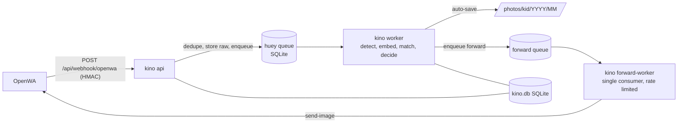

# Kino

Kino is a self-hosted service that listens to WhatsApp group messages through [OpenWA](https://github.com/rmyndharis/openwa), finds your kids in the incoming photos (including small, far-away faces), saves each photo into a per-kid folder, and forwards the saved photo to a WhatsApp chat you choose. Everything runs locally on CPU; no photo or face embedding leaves your host except the forwarded photo you asked for.

Named after the floating recording drones of Stargate Universe.

## Status / known gaps

This is the M1 milestone: the processing pipeline and a CLI. There is **no web UI yet**, and no review queue, clustering, backfill, retention cleanup, digest or burst propagation (their settings are accepted but have no effect). Matches that would not be auto-saved are recorded in the database only; there is nothing to review them with yet.

The OpenWA integration was checked read-only against a live OpenWA 0.24.0 instance (its OpenAPI spec and stored messages): the webhook filter grammar, the sender field (`author`, a privacy `@lid` id, falling back to `from`), the serialized message id format and the media download endpoint match. No real webhook delivery has been received yet, so these remain **unverified**:

- the real webhook delivery shape and its signature header
- the envelope `sessionId` (assumed to equal the session id used in REST paths)
- the `messageId` returned by send-image

`kino openwa register-webhook` updates a webhook that has the same URL; if the instance already has other webhooks (for example from another integration), it creates an additional one and leaves the others alone.

If your OpenWA differs, the first webhook delivery is where it will show up (see Troubleshooting).

## Features (M1)

- OpenWA webhook receiver with mandatory HMAC-SHA256 verification and a session check
- Group auto-discovery; only groups you mark as watched are processed
- Duplicate detection (perceptual hash) so a photo forwarded into several groups is processed once
- Face detection with SCRFD, full-image pass plus a tiled pass for small or distant faces
- Face quality tiers (size, blur, pose) and embedding on CPU with onnxruntime
- Matching against per-kid reference galleries, with thresholds per size tier, per-kid offset, group prior and a margin check
- Auto-save per kid (opt-in) to `photos/<kid>/<YYYY>/<MM>/<date>_<group>_<id>.jpg`, with EXIF date, description and artist; siblings in one photo are hardlinked
- Forwarding of saved photos to a configured WhatsApp chat through a single rate-limited queue, with retries
- Prometheus metrics at `/metrics`, `/healthz` and `/readyz`
- CLI for enrolling kids, managing groups and kids, setting the forward destination, registering the webhook and benchmarking the pipeline

## How it works



`kino-api`, `kino-worker` and `kino-forward-worker` are the same image started with different commands, sharing the `/data` volume.

## Requirements

- Docker with Compose (amd64 or arm64), or Python 3.12 for a local install
- A running OpenWA with a connected WhatsApp session, its URL, API key and session id
- About 3 GB of RAM for the worker and a few hundred MB of disk for models (downloaded on first use)

## Installation

### Docker Compose (recommended)

```bash
git clone https://github.com/t0mer/kino && cd kino
cp .env.example .env
# edit .env: KINO_OPENWA_API_KEY, KINO_OPENWA_SESSION_ID, KINO_WEBHOOK_SECRET (openssl rand -hex 32)
mkdir -p photos && sudo chown 1000:1000 photos   # the container runs as uid 1000
docker compose up -d
```

The example compose file publishes the API (8080) and OpenWA (2785) on `127.0.0.1` only. OpenWA is reached by Kino over the internal Docker network and should stay private. To reach Kino from elsewhere, put a Cloudflare Tunnel or a reverse proxy in front of it (do not route `/api/webhook/openwa` there), or change the mapping to `8080:8080` on a trusted LAN only; M1 has no UI login.

`/data` is a named volume (`kino-data`) holding the database, queues, raw images, crops and models. The `./photos` bind mount must be writable by uid 1000. Run the forward worker as exactly one instance; do not scale it.

Then, using the CLI inside the running container (`docker compose exec kino-api kino ...`):

```bash
# 1. Download the models (otherwise they are fetched on first use)
docker compose exec kino-api kino models download

# 2. Register Kino's webhook in OpenWA
docker compose exec kino-api kino openwa register-webhook

# 3. Enroll each kid from a folder of clear photos (10 or more, varied angles)
docker compose run --rm -v "$PWD/enroll/Noa:/enroll:ro" kino-api enroll "Noa" /enroll

# 4. Find your groups (they appear once a message arrives, or fetch names from OpenWA) and watch them
docker compose exec kino-api kino groups list
docker compose exec kino-api kino groups watch 1203...@g.us --kid Noa --fetch

# 5. Check results in the database/logs, then turn on auto-save for the kid
docker compose exec kino-api kino kids set-auto-save Noa --on

# 6. Choose where saved photos are forwarded (must not be a watched group)
docker compose exec kino-api kino forward set 972501234567@c.us
```

Until auto-save is on for a kid, matches are not saved. Forwarding is off until `kino forward set` is run.

### Local install

```bash
uv venv && uv pip install -e ".[dev]"
KINO_DATA_DIR=./data KINO_PHOTOS_DIR=./data/photos KINO_WEBHOOK_SECRET=$(openssl rand -hex 32) .venv/bin/kino migrate
```

## Configuration

Precedence: environment variables (`KINO_*`) > `/data/config.yaml` (in `KINO_DATA_DIR`; keys are the variable names without the prefix, see `config.example.yaml`) > built-in defaults.

| Variable | Default | Description |
|---|---|---|
| `KINO_DATA_DIR` | `/data` | Root for the database, queues, raw images, crops, models and `config.yaml` |
| `KINO_PHOTOS_DIR` | `/data/photos` | Output root for saved photos |
| `KINO_STRIP_GPS` | `true` | Remove GPS EXIF from saved (and therefore forwarded) photos |
| `KINO_TIMEZONE` | `UTC` | IANA zone used for photo folders, file names and EXIF local time (for example `Asia/Jerusalem`) |
| `KINO_OPENWA_URL` | unset | OpenWA base URL, for example `http://openwa:2785` |
| `KINO_OPENWA_API_KEY` | unset | OpenWA API key; needed by the api, the forward worker and the OpenWA CLI commands |
| `KINO_OPENWA_SESSION_ID` | unset | The single OpenWA session; webhooks from other sessions are rejected |
| `KINO_WEBHOOK_SECRET` | unset | HMAC secret for webhook verification. Required: Kino refuses to start without it |
| `KINO_ADMIN_USER` | unset | Admin user name (reserved for the web UI) |
| `KINO_ADMIN_PASSWORD_HASH` | unset | Admin password hash (reserved for the web UI) |
| `KINO_SECRET_KEY` | unset | Cookie signing key (reserved for the web UI) |
| `KINO_CF_ACCESS_TEAM_DOMAIN` | unset | Cloudflare Access team domain (reserved for the web UI) |
| `KINO_CF_ACCESS_AUD` | unset | Cloudflare Access application AUD tag (reserved for the web UI) |
| `KINO_CF_ACCESS_ALLOWED_EMAILS` | unset | Comma-separated allowed emails (reserved for the web UI) |
| `KINO_METRICS_PUBLIC` | `false` | Serve `/metrics` without authentication |
| `KINO_METRICS_DIR` | `<KINO_DATA_DIR>/metrics` | Shared directory where every Kino process (API, workers, forward worker) writes its Prometheus counters; `/metrics` merges them |
| `KINO_EMBEDDER` | `auraface` | `auraface` or `buffalo_l` (see Model licensing) |
| `KINO_DET_SIZE` | `1024` | Detector input size for the full-image pass; a multiple of 32, at least 32 |
| `KINO_TILING` | `auto` | `off`, `auto` or `always` |
| `KINO_TILE_GRID` | `auto` | `2x2`, `3x3` or `auto` |
| `KINO_TILE_OVERLAP` | `0.2` | Tile overlap, from 0 up to but excluding 1 |
| `KINO_WORKERS` | `2` | Worker processes for `kino worker` (at least 1) |
| `KINO_ORT_THREADS` | `2` | onnxruntime threads per process (at least 1) |
| `KINO_FORWARD_RATE_PER_MIN` | `6` | Maximum forwarded photos per minute (at least 1) |
| `KINO_RAW_RETENTION_DAYS` | `7` | Reserved; retention cleanup is not implemented in M1 |
| `KINO_FACE_RETENTION_DAYS` | `30` | Reserved; retention cleanup is not implemented in M1 |
| `KINO_BURST_ENABLED` | `false` | Reserved; burst propagation is not implemented in M1 |
| `KINO_DIGEST_CRON` | `0 20 * * *` | Reserved; the review digest is not implemented in M1 |
| `KINO_APPRISE_URLS` | unset | Reserved; the review digest is not implemented in M1 |
| `KINO_LOG_LEVEL` | `INFO` | Log level |
| `KINO_LOG_JSON` | `false` | JSON log lines |

The Docker image additionally reads `KINO_VERSION`, set at build time from the release version and reported by `kino version` and `/healthz`.

## CLI reference

Run `kino --help` or `kino <command> --help` for all options. In the container the entrypoint is `kino`, so `docker run techblog/kino version` works.

| Command | Description |
|---|---|
| `kino version` | Print the version |
| `kino migrate` | Create or upgrade the database schema (the api and workers also migrate on start) |
| `kino api [--host] [--port]` | Run the HTTP API (default `0.0.0.0:8080`) |
| `kino worker [-w N]` | Run the image-processing worker (main queue) |
| `kino forward-worker` | Run the forwarding worker; run exactly one instance |
| `kino enroll <kid> <dir> [--slug] [--birth-year] [--group]` | Enroll reference faces for a kid from a folder of photos (kid created if missing) |
| `kino bench <dir> [--repeat N]` | Time detect, quality and embed on real images without database writes |
| `kino models download [--embedder auraface\|buffalo_l] [--all]` | Download and verify models |
| `kino groups list` | List discovered groups |
| `kino groups watch <chat_id> [--kid NAME]... [--fetch]` | Watch a group; `--kid` replaces its kid mapping, `--fetch` imports group names from OpenWA |
| `kino groups unwatch <chat_id>` | Stop watching a group |
| `kino kids list` | List kids |
| `kino kids set-auto-save <kid> --on\|--off` | Enable or disable auto-save for a kid |
| `kino kids set-offset <kid> <offset>` | Shift a kid's thresholds (positive is stricter; allowed range -0.10 to +0.30; use `--` before negative values). Whatever the offset and group prior, the tier L/M auto-save threshold never goes below 0.30 |
| `kino forward set <chat_id>` | Set the default forward destination and enable forwarding |
| `kino forward show` | Show the forwarding configuration |
| `kino forward disable` | Disable forwarding (destination kept) |
| `kino forward list [--status S] [--limit N]` | List forwards, newest first (`pending`, `sent`, `failed`, `cancelled`) |
| `kino forward retry <id>` | Retry a failed forward |
| `kino openwa register-webhook [--url URL]` | Register or update the webhook in OpenWA (default URL `http://kino-api:8080/api/webhook/openwa`) |

## API endpoints

| Method and path | Purpose |
|---|---|
| `POST /api/webhook/openwa` | OpenWA webhook (HMAC-verified) |
| `GET /healthz` | Liveness; returns status and version |
| `GET /readyz` | Readiness |
| `GET /metrics` | Prometheus metrics; blocked unless `KINO_METRICS_PUBLIC=true` |

`/metrics` merges the counters written by all Kino processes (prometheus_client multiprocess mode, files in `KINO_METRICS_DIR`) and adds gauges read from the database at scrape time: `kino_queue_depth`, `kino_review_queue_size`, `kino_gallery_refs{kid,source}` and `kino_forward_queue_depth`. `kino_model_info` is set by each worker process once its models are loaded. Each process deletes the metric files of dead processes from its own container when it starts; after recreating containers you can clear stale files by deleting the directory while all Kino containers are stopped.

## Privacy and retention

- Other children appear in group photos. Kino stores raw images, face crops and embeddings of every detected face in `/data` while it processes them. **Automatic cleanup (retention) is not implemented in M1**, so those files stay until you delete them; the `*_RETENTION_DAYS` settings do not act yet.
- Saved photos keep the original image bytes; only EXIF is rewritten (date, group name as description, sender as artist). All metadata segments except JFIF, ICC and Adobe colour data (Exif/GPS, XMP, IPTC, MPF, comments and other APPn, including any between scans or after the image end) are removed by default (`KINO_STRIP_GPS`), and forwarded photos are these stripped saved copies.
- Folder names and dates use `KINO_TIMEZONE`.
- No photo or embedding is sent anywhere except the saved photo forwarded to your chosen chat through OpenWA.
- Logs do not include image bytes or embeddings.

## Security notes

- The webhook requires a valid HMAC signature and the configured session id; without `KINO_WEBHOOK_SECRET` the service refuses to start.
- `/metrics` is not public by default.
- Keep `.env` out of version control; secrets are never baked into the image and no model files are included.
- The webhook is meant to be reached by OpenWA over the internal Docker network only; do not expose it publicly.
- The example `docker-compose.yml` binds the Kino API and OpenWA to `127.0.0.1`. Expose Kino only through a tunnel or reverse proxy (M1 has no UI authentication), and never expose OpenWA.
- Never choose a watched group as the forward destination (Kino would ingest its own photos).

## Model licensing

- **AuraFace-v1** (default recognition model): Apache-2.0.
- **InsightFace `buffalo_l`** (optional, `KINO_EMBEDDER=buffalo_l`): non-commercial research use only. Kino prints a warning at startup when it is selected.
- **SCRFD-10GF detector weights**: fetched from the InsightFace `buffalo_l` pack, whose pretrained models are licensed for **non-commercial research use only**. This applies to the default setup as well. The `Detector` interface is pluggable so a permissively licensed detector can replace it.
- Ultralytics / YOLOv8+ (AGPL) are not used; CI fails if an AGPL dependency or `ultralytics` is installed.

Models are downloaded into `/data/models` (SHA-256 verified), never baked into the image.

## Troubleshooting

- **API exits at start with a message about `KINO_WEBHOOK_SECRET`**: set it in `.env`.
- **Webhook returns 401 or 403**: the HMAC secret differs between OpenWA and `KINO_WEBHOOK_SECRET`, or the payload's session id is not `KINO_OPENWA_SESSION_ID`.
- **Photos from a group are ignored**: the group is not watched; check `kino groups list` and run `kino groups watch`.
- **Matches are not saved**: auto-save is off for the kid (`kino kids set-auto-save`), or the face is below the auto-save size tier.
- **Nothing is forwarded**: run `kino forward show`; forwarding needs a destination, the OpenWA settings, and the `forward-worker` running. Failed sends are listed by `kino forward list --status failed`.
- **Permission denied writing photos**: the `./photos` bind mount must be writable by uid 1000.
- **Model download errors**: check outbound access to GitHub releases, then run `kino models download`.

## Development

```bash
uv venv && uv pip install -e ".[dev]"
.venv/bin/pytest                 # tests marked "models" (network) are skipped by default
.venv/bin/ruff check . && .venv/bin/ruff format --check .
.venv/bin/mypy kino              # strict for kino.pipeline, kino.api, kino.forward, kino.tasks
docker build --build-arg VERSION=dev -t kino:dev .
```

Releases: run the "Docker Build" workflow (manual); it publishes `techblog/kino:latest` and `techblog/kino:<YYYY.M.PATCH>` for linux/amd64 and linux/arm64, then tags the commit.

## Contributing

Issues and pull requests are welcome. Please run the checks above before opening a pull request.

## License

Apache-2.0, see [LICENSE](LICENSE). Model weights carry their own licenses (see Model licensing).
